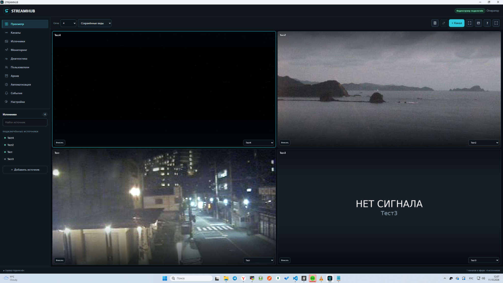
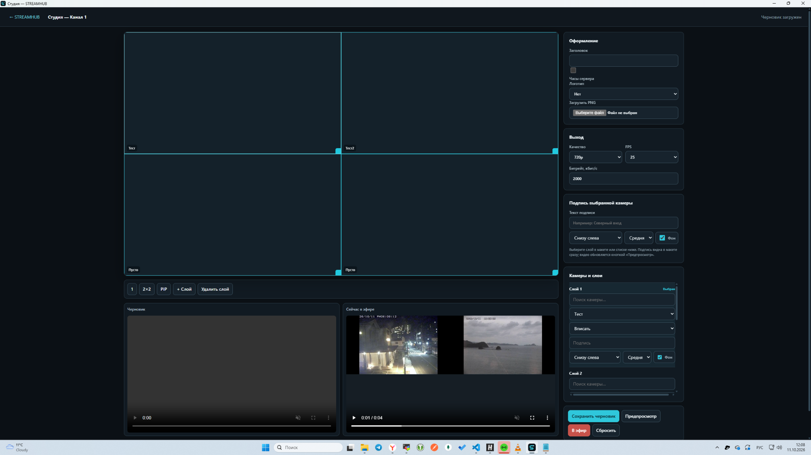
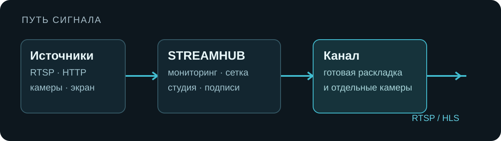

<p align="center">
  
</p>

<p align="center">
  <strong>Камеры и потоки → раскладка → канал → зрители.</strong><br>
  Локальное приложение для Windows, которое собирает источники в видеостену и выдаёт готовые трансляции по сети.
</p>

<p align="center">
  <a href="#возможности">Возможности</a> ·
  <a href="#как-это-работает">Как это работает</a> ·
  <a href="#установка">Установка</a> ·
  <a href="#разработка">Разработка</a>
</p>

## Как выглядит

Настоящие экраны версии 1.6.4 на Windows. В демонстрационной раскладке часть тестовых источников без сигнала.



<details>
<summary>Студия: слои, подписи и настройки канала</summary>



</details>

## Возможности

| | |
| --- | --- |
| **Источники** | RTSP и HTTP потоки, сетевые камеры, захват экрана и устройств; выбор TCP/UDP для RTSP источника, включение и повторная инициализация. |
| **Видеостена** | Несколько сеток, в том числе 3 × 2 и 5 × 4; закрепление камер и просмотр состояния. |
| **Студия каналов** | Слои, подписи, логотип, черновик и вывод в эфир; отдельные ссылки на канал и камеру. |
| **Наблюдение** | Доступность камер, история состояния и обрывов, свободные источники, диагностика процессов. |
| **Управление** | Пользователи и роли, архив и запись, автоматизация, поиск источников. |

Это исходники и интерфейс продукта, а не обещание беспрерывной работы с любым оборудованием: поведение конкретной камеры и кодека нужно проверять на месте.

## Как это работает

<p align="center">
  
</p>

Добавьте источник, соберите сетку на видеостене или откройте студию канала, затем скопируйте ссылку для просмотра. Для диагностики сигнала есть мониторинг источников. Сервер использует FFmpeg и MediaMTX; приложение работает локально и может отдавать поток другим клиентам в сети.

## Установка

**Windows 10/11.** Установщик версии 1.6.4 подготовлен, но в GitHub Releases пока не опубликован. Когда появится ссылка на скачивание, она будет здесь. Скачав установщик, запустите его и откройте STREAMHUB через ярлык. Дополнительные зависимости должны входить в полный установщик.

При обновлении установщик останавливает и отключает автозапуск прежней службы `VideowallServer`, сохраняя её регистрацию и данные. Изменения версии и список проверок перед установкой — в [CHANGELOG.md](CHANGELOG.md).

## Разработка

```text
src/        Electron, сервер, интерфейс, FFmpeg/MediaMTX интеграция
tests/      проверки логики записи, зрителей и резервных копий
installer/  сценарий NSIS для полной Windows сборки
```

Проверки из корня репозитория:

```bash
node --test tests/*.test.cjs
```

Сценарий NSIS не собирается из одного только Git checkout: ему нужны Windows Electron runtime, FFmpeg, MediaMTX и ресурсы в `stage160/`, а также payload в `payload160/`. Эти крупные файлы не хранятся в Git. Для установки поверх предыдущей версии, записи с TCP/UDP и студии нужна проверка на Windows с реальными потоками.

## Проект

**STREAMHUB 1.6.4** · Hexent studio · [streamhub@hexent.ru](mailto:streamhub@hexent.ru) · [История изменений](CHANGELOG.md) · [Как работать с GitHub](docs/GITHUB.md)

Лицензия на использование и распространение исходников пока не опубликована. Наличие публичного репозитория само по себе не даёт разрешения на перепродажу или распространение сборок.
